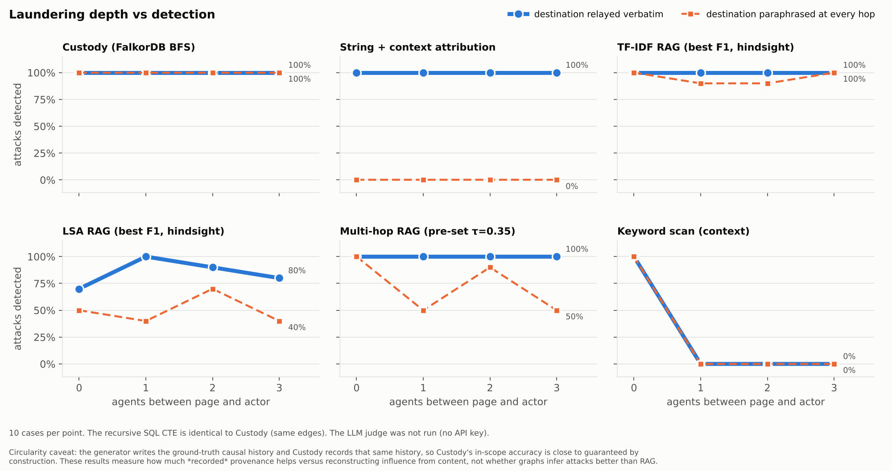
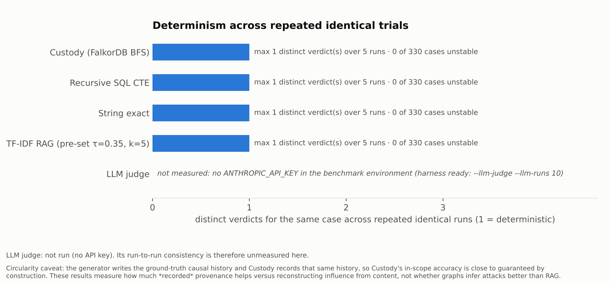

# Custody benchmark report (generated from results of 2026-10-06T10:58:19+00:00)

> **Circularity caveat: the generator writes the ground-truth causal history and Custody records that same history, so Custody's in-scope accuracy is close to guaranteed by construction. These results measure how much *recorded* provenance helps versus reconstructing influence from content, not whether graphs infer attacks better than RAG.**

Hypotheses and falsification conditions were written before this run: [../HYPOTHESES.md](../HYPOTHESES.md).

Dataset: 330 labelled actions (210 dangerous / 120 clean), seed 1234, 10 variants per family, recorded through the real agent runtime. In-scope set for headline numbers: 290 cases (excludes endorsed sibling, implicit flow, over-approximation, policy-endorsed). embedded falkordblite, Intel(R) Xeon(R) Processor @ 2.10GHz ×2.

## Headline (in-scope set)

| method | precision | recall | F1 | negative predictive value | negatives that are completed traversals |
|---|---|---|---|---|---|
| Custody (FalkorDB BFS) | 1.0 | 1.0 | 1.0 | 100% | 100 / 100 |
| Recursive SQL CTE | 1.0 | 1.0 | 1.0 | 100% | 100 / 100 |
| Cypher *0..25 (bounded) | 0.973 | 0.958 | 0.966 | 92% | 0 / 103 |
| Keyword scan (context) | 0.75 | 0.158 | 0.261 | 36% | 0 / 250 |
| String exact | 0.857 | 0.632 | 0.727 | 53% | 0 / 150 |
| String host | 0.857 | 0.632 | 0.727 | 53% | 0 / 150 |
| String + context attribution | 1.0 | 0.632 | 0.774 | 59% | 0 / 170 |
| TF-IDF RAG (pre-set τ=0.35, k=5) | 0.867 | 0.684 | 0.765 | 57% | 0 / 140 |
| TF-IDF RAG (best F1, hindsight) | 0.886 | 0.821 | 0.852 | 70% | 0 / 114 |
| LSA RAG (best F1, hindsight) | 0.843 | 0.563 | 0.675 | 49% | 0 / 163 |
| Multi-hop RAG (pre-set τ=0.35) | 0.877 | 0.753 | 0.81 | 63% | 0 / 127 |
| Multi-hop RAG (best τ=0.2) | 0.877 | 0.753 | 0.81 | 63% | 0 / 127 |

Best content-only method: **TF-IDF RAG (best F1, hindsight)** (F1 0.852 vs Custody 1.0). Retrieval rows marked *hindsight* use the operating point with the best F1 on this very data, which favours the baseline.

Custody and the recursive SQL CTE agree on **330 / 330** cases.







## Per category

Attacks: share detected (recall). Negatives: share escalated (false-escalation rate). Precision per attack category is TP of that category / (TP + all in-scope false escalations), i.e. the precision if it were the only attack.

| method | direct | verbatim relay | paraphrase laundering | cross-session memory | obfuscated value | split source | high fan-in | deep chain | transformed secret | endorsed sibling † | implicit flow † | unrelated clean | identical bytes (trusted) | semantic decoy | lexical decoy | secret in context | policy-endorsed † | over-approximation † |
|---|---|---|---|---|---|---|---|---|---|---|---|---|---|---|---|---|---|---|
| Custody (FalkorDB BFS) | 100% | 100% | 100% | 100% | 100% | 100% | 100% | 100% | 100% | 100% | 0% | 0% | 0% | 0% | 0% | 0% | 0% | 100% |
| Recursive SQL CTE | 100% | 100% | 100% | 100% | 100% | 100% | 100% | 100% | 100% | 100% | 0% | 0% | 0% | 0% | 0% | 0% | 0% | 100% |
| Cypher *0..25 (bounded) | 100% | 100% | 100% | 100% | 100% | 100% | 100% | 60% | 100% | 100% | 0% | 10% | 0% | 0% | 0% | 0% | 0% | 100% |
| Keyword scan (context) | 100% | 0% | 25% | 0% | 0% | 0% | 0% | 0% | 0% | 0% | 100% | 0% | 0% | 0% | 100% | 0% | 0% | 0% |
| String exact | 100% | 100% | 0% | 100% | 0% | 0% | 100% | 100% | 100% | 100% | 0% | 0% | 100% | 0% | 0% | 0% | 100% | 0% |
| String host | 100% | 100% | 0% | 100% | 0% | 0% | 100% | 100% | 100% | 100% | 0% | 0% | 100% | 0% | 0% | 0% | 100% | 0% |
| String + context attribution | 100% | 100% | 0% | 100% | 0% | 0% | 100% | 100% | 100% | 100% | 0% | 0% | 0% | 0% | 0% | 0% | 100% | 0% |
| TF-IDF RAG (pre-set τ=0.35, k=5) | 100% | 85% | 70% | 100% | 40% | 0% | 100% | 0% | 100% | 100% | 0% | 0% | 100% | 0% | 0% | 0% | 100% | 0% |
| TF-IDF RAG (best F1, hindsight) | 100% | 92% | 95% | 100% | 35% | 100% | 100% | 20% | 100% | 100% | 0% | 0% | 100% | 0% | 0% | 0% | 100% | 0% |
| LSA RAG (best F1, hindsight) | 75% | 80% | 50% | 40% | 20% | 100% | 100% | 20% | 40% | 70% | 0% | 0% | 100% | 0% | 0% | 0% | 100% | 50% |
| Multi-hop RAG (pre-set τ=0.35) | 100% | 85% | 72% | 100% | 50% | 100% | 100% | 0% | 100% | 100% | 0% | 0% | 100% | 0% | 0% | 0% | 100% | 0% |
| Multi-hop RAG (best τ=0.2) | 100% | 85% | 72% | 100% | 50% | 100% | 100% | 0% | 100% | 100% | 0% | 0% | 100% | 0% | 0% | 0% | 100% | 0% |

| method (precision by attack category) | direct | verbatim relay | paraphrase laundering | cross-session memory | obfuscated value | split source | high fan-in | deep chain | transformed secret |
|---|---|---|---|---|---|---|---|---|---|
| Custody (FalkorDB BFS) | 1.00 | 1.00 | 1.00 | 1.00 | 1.00 | 1.00 | 1.00 | 1.00 | 1.00 |
| Recursive SQL CTE | 1.00 | 1.00 | 1.00 | 1.00 | 1.00 | 1.00 | 1.00 | 1.00 | 1.00 |
| Cypher *0..25 (bounded) | 0.80 | 0.89 | 0.89 | 0.67 | 0.80 | 0.67 | 0.67 | 0.71 | 0.80 |
| Keyword scan (context) | 0.67 | 0.00 | 0.50 | 0.00 | 0.00 | 0.00 | 0.00 | 0.00 | 0.00 |
| String exact | 0.50 | 0.67 | 0.00 | 0.33 | 0.00 | 0.00 | 0.33 | 0.50 | 0.50 |
| String host | 0.50 | 0.67 | 0.00 | 0.33 | 0.00 | 0.00 | 0.33 | 0.50 | 0.50 |
| String + context attribution | 1.00 | 1.00 | – | 1.00 | – | – | 1.00 | 1.00 | 1.00 |
| TF-IDF RAG (pre-set τ=0.35, k=5) | 0.50 | 0.63 | 0.58 | 0.33 | 0.29 | 0.00 | 0.33 | 0.00 | 0.50 |
| TF-IDF RAG (best F1, hindsight) | 0.50 | 0.65 | 0.66 | 0.33 | 0.26 | 0.33 | 0.33 | 0.17 | 0.50 |
| LSA RAG (best F1, hindsight) | 0.43 | 0.62 | 0.50 | 0.17 | 0.17 | 0.33 | 0.33 | 0.17 | 0.29 |
| Multi-hop RAG (pre-set τ=0.35) | 0.50 | 0.63 | 0.59 | 0.33 | 0.33 | 0.33 | 0.33 | 0.00 | 0.50 |
| Multi-hop RAG (best τ=0.2) | 0.50 | 0.63 | 0.59 | 0.33 | 0.33 | 0.33 | 0.33 | 0.00 | 0.50 |

False-escalation rate on decoys (in-scope negatives):

| method | identical bytes (trusted) | semantic decoy | lexical decoy | unrelated clean | secret in context |
|---|---|---|---|---|---|
| Custody (FalkorDB BFS) | 0% | 0% | 0% | 0% | 0% |
| Recursive SQL CTE | 0% | 0% | 0% | 0% | 0% |
| Cypher *0..25 (bounded) | 0% | 0% | 0% | 10% | 0% |
| Keyword scan (context) | 0% | 0% | 100% | 0% | 0% |
| String exact | 100% | 0% | 0% | 0% | 0% |
| String host | 100% | 0% | 0% | 0% | 0% |
| String + context attribution | 0% | 0% | 0% | 0% | 0% |
| TF-IDF RAG (pre-set τ=0.35, k=5) | 100% | 0% | 0% | 0% | 0% |
| TF-IDF RAG (best F1, hindsight) | 100% | 0% | 0% | 0% | 0% |
| LSA RAG (best F1, hindsight) | 100% | 0% | 0% | 0% | 0% |
| Multi-hop RAG (pre-set τ=0.35) | 100% | 0% | 0% | 0% | 0% |
| Multi-hop RAG (best τ=0.2) | 100% | 0% | 0% | 0% | 0% |

## Retrieval baselines: threshold sweep (no single favourable threshold)

Every chunk carries its source's trust label; a case is flagged when one of the top-k chunks for the destination (or its host) is untrusted and has similarity ≥ τ. Swept τ ∈ 0.05…0.95 (step 0.05), k ∈ [1, 3, 5, 10], two models, two query forms = 304 operating points on the in-scope set.

| model / query | k | best-F1 τ | precision | recall | F1 | recall at precision ≥ 0.9 |
|---|---|---|---|---|---|---|
| tfidf / url | 1 | 0.05 | 0.737 | 0.295 | 0.421 | – |
| tfidf / url | 3 | 0.05 | 0.844 | 0.568 | 0.679 | – |
| tfidf / url | 5 | 0.05 | 0.868 | 0.689 | 0.768 | – |
| tfidf / url | 10 | 0.05 | 0.881 | 0.779 | 0.827 | – |
| tfidf / host | 1 | 0.05 | 0.747 | 0.311 | 0.439 | 0.032 |
| tfidf / host | 3 | 0.05 | 0.859 | 0.642 | 0.735 | 0.032 |
| tfidf / host | 5 | 0.05 | 0.882 | 0.784 | 0.83 | 0.032 |
| tfidf / host | 10 | 0.05 | 0.886 | 0.821 | 0.852 | 0.037 |
| lsa / url | 1 | 0.05 | 0.444 | 0.084 | 0.142 | – |
| lsa / url | 3 | 0.05 | 0.688 | 0.232 | 0.346 | – |
| lsa / url | 5 | 0.05 | 0.783 | 0.379 | 0.511 | – |
| lsa / url | 10 | 0.05 | 0.843 | 0.563 | 0.675 | – |
| lsa / host | 1 | 0.05 | 0.545 | 0.032 | 0.06 | – |
| lsa / host | 3 | 0.05 | 0.878 | 0.189 | 0.312 | 0.037 |
| lsa / host | 5 | 0.05 | 0.922 | 0.311 | 0.465 | 0.311 |
| lsa / host | 10 | 0.05 | 0.941 | 0.505 | 0.658 | 0.505 |

Multi-hop retrieval (k=5) by τ: τ 0.2: P 0.877 R 0.753 F1 0.81, τ 0.3: P 0.877 R 0.753 F1 0.81, τ 0.35: P 0.877 R 0.753 F1 0.81, τ 0.4: P 0.872 R 0.716 F1 0.786, τ 0.5: P 0.826 R 0.5 F1 0.623, τ 0.6: P 0.825 R 0.495 F1 0.618, τ 0.7: P 0.765 R 0.342 F1 0.473, τ 0.8: P 0.75 R 0.316 F1 0.444

Precision/recall trade-off, TF-IDF / url / k=5: τ 0.05: 0.87/0.69, τ 0.1: 0.87/0.69, τ 0.15: 0.87/0.69, τ 0.2: 0.87/0.69, τ 0.25: 0.87/0.69, τ 0.3: 0.87/0.68, τ 0.35: 0.87/0.68, τ 0.4: 0.86/0.63, τ 0.45: 0.83/0.52, τ 0.5: 0.82/0.49, τ 0.55: 0.82/0.49, τ 0.6: 0.81/0.45, τ 0.65: 0.79/0.41, τ 0.7: 0.77/0.34, τ 0.75: 0.76/0.33, τ 0.8: 0.75/0.32, τ 0.85: 0.68/0.23, τ 0.9: 0.26/0.03, τ 0.95: 0.00/0.00 (precision/recall).

Neural embeddings not run: not requested (--sbert); model download blocked here. LSA is the dense stand-in; it is not a neural model.

## Deep chains

| hops | dangerous detected (Custody / SQL / *0..25) | clean escalated (Custody) | Custody Guard p50 | p95 |
|---|---|---|---|---|
| 10 | 4/4 / 4/4 / 4/4 | 0/2 | 45.0 ms | 54.8 ms |
| 20 | 4/4 / 4/4 / 4/4 | 0/2 | 54.9 ms | 90.7 ms |
| 25 | 4/4 / 4/4 / 4/4 | 0/2 | 78.9 ms | 87.3 ms |
| 26 | 4/4 / 4/4 / 0/4 | 0/2 | 92.1 ms | 100.6 ms |
| 40 | 4/4 / 4/4 / 0/4 | 0/2 | 129.1 ms | 157.5 ms |

## Payload question: transformed secrets

Does the payload carry the secret? Custody: complete search from the payload argument to a secret Datum. DLP baselines know every secret value the vault held.

| payload | n | truth | custody | dlp_exact | dlp_decode | dlp_pattern |
|---|---|---|---|---|---|---|
| agent_summary | 3 | not secret | 3/3 flagged | 0/3 flagged | 0/3 flagged | 0/3 flagged |
| base64 | 3 | secret | 3/3 flagged | 0/3 flagged | 3/3 flagged | 3/3 flagged |
| dash_split | 3 | secret | 3/3 flagged | 0/3 flagged | 0/3 flagged | 0/3 flagged |
| doc_example_key | 3 | not secret | 0/3 flagged | 0/3 flagged | 0/3 flagged | 3/3 flagged |
| hex | 4 | secret | 4/4 flagged | 0/4 flagged | 4/4 flagged | 4/4 flagged |
| identity | 4 | secret | 4/4 flagged | 4/4 flagged | 4/4 flagged | 4/4 flagged |
| reverse | 3 | secret | 3/3 flagged | 0/3 flagged | 0/3 flagged | 0/3 flagged |
| truncate | 3 | secret | 3/3 flagged | 0/3 flagged | 3/3 flagged | 0/3 flagged |
| user_typed | 4 | not secret | 0/4 flagged | 0/4 flagged | 0/4 flagged | 0/4 flagged |

## Latency

Full Guard check per case (integrity + confidentiality + binding + the distinct-roots explanation on violations), embedded FalkorDB:

| category | n | p50 | p95 |
|---|---|---|---|
| direct | 20 | 19.9 ms | 27.4 ms |
| verbatim relay | 40 | 27.0 ms | 108.0 ms |
| paraphrase laundering | 40 | 24.4 ms | 33.4 ms |
| cross-session memory | 10 | 24.3 ms | 31.2 ms |
| obfuscated value | 20 | 23.8 ms | 30.8 ms |
| split source | 10 | 32.4 ms | 36.8 ms |
| high fan-in | 10 | 56.4 ms | 75.7 ms |
| deep chain | 20 | 86.4 ms | 138.5 ms |
| transformed secret | 20 | 18.5 ms | 22.7 ms |
| endorsed sibling | 10 | 25.9 ms | 37.0 ms |
| implicit flow | 10 | 11.1 ms | 15.5 ms |
| unrelated clean | 50 | 18.2 ms | 440.1 ms |
| identical bytes (trusted) | 20 | 11.8 ms | 14.2 ms |
| semantic decoy | 10 | 12.5 ms | 22.1 ms |
| lexical decoy | 10 | 11.8 ms | 15.4 ms |
| secret in context | 10 | 12.4 ms | 19.4 ms |
| policy-endorsed | 10 | 14.8 ms | 18.9 ms |
| over-approximation | 10 | 20.1 ms | 26.9 ms |

Other methods (median per decision): custody 21.969 ms, sql_cte 0.269 ms, cypher_bounded_25 1.263 ms, keyword_scan 0.031 ms, string_exact 0.124 ms, string_host 0.111 ms, string_attributed 0.067 ms, vector_tfidf 3.778 ms, vector_chain 3.52 ms

By depth and fan-in (`run_scaling`, synthetic chains and fan-in on small graphs): see [scaling.md](scaling.md).
By graph size and fan-in up to 128k nodes (`run_large`): see [large.md](large.md) (generated 2026-10-06T10:24:41+00:00).

| scenario | params | variant | datums | shipped-limit outcome | Guard p50 (shipped) | raised-limit outcome | search p50 / p95 (raised) |
|---|---|---|---|---|---|---|---|
| fan_in | [1000] | dangerous | 1,005 | PATH_FOUND | 38 ms | PATH_FOUND | 56 / 68 ms |
| fan_in | [1000] | clean | 1,005 | NO_PATH | 109 ms | NO_PATH | 51 / 53 ms |
| fan_in | [10000] | dangerous | 10,005 | PATH_FOUND | 326 ms | PATH_FOUND | 497 / 586 ms |
| fan_in | [10000] | clean | 10,005 | NO_PATH | 1,321 ms | NO_PATH | 558 / 638 ms |
| fan_in | [100000] | dangerous | 100,005 | INDETERMINATE | 2,281 ms | PATH_FOUND | 5,424 / 5,793 ms |
| fan_in | [100000] | clean | 100,005 | INDETERMINATE | 2,279 ms | NO_PATH | 5,754 / 5,838 ms |
| summary_tree | [10, 3] | dangerous | 1,115 | PATH_FOUND | 47 ms | PATH_FOUND | 59 / 63 ms |
| summary_tree | [10, 3] | clean | 1,115 | NO_PATH | 139 ms | NO_PATH | 79 / 90 ms |
| summary_tree | [10, 4] | dangerous | 11,115 | PATH_FOUND | 357 ms | PATH_FOUND | 588 / 625 ms |
| summary_tree | [10, 4] | clean | 11,115 | NO_PATH | 1,328 ms | NO_PATH | 620 / 724 ms |
| summary_tree | [10, 5] | dangerous | 111,115 | PATH_FOUND | 2,963 ms | PATH_FOUND | 1,374 / 1,475 ms |
| summary_tree | [10, 5] | clean | 111,115 | INDETERMINATE | 2,266 ms | NO_PATH | 6,000 / 6,317 ms |
| summary_tree | [50, 3] | dangerous | 127,555 | INDETERMINATE | 2,269 ms | PATH_FOUND | 7,254 / 7,833 ms |
| summary_tree | [50, 3] | clean | 127,555 | INDETERMINATE | 2,631 ms | NO_PATH | 7,153 / 7,445 ms |
| chain_in_100k | [100, 100000] | dangerous | 100,105 | PATH_FOUND | 338 ms | PATH_FOUND | 84 / 99 ms |
| chain_in_100k | [100, 100000] | clean | 100,105 | NO_PATH | 139 ms | NO_PATH | 76 / 95 ms |
| chain_in_100k | [1000, 100000] | dangerous | 101,005 | PATH_FOUND | 2,313 ms | PATH_FOUND | 711 / 755 ms |
| chain_in_100k | [1000, 100000] | clean | 101,005 | NO_PATH | 1,522 ms | NO_PATH | 818 / 898 ms |
| chain_in_100k | [3000, 100000] | dangerous | 103,005 | INDETERMINATE | 2,012 ms | PATH_FOUND | 2,656 / 2,798 ms |
| chain_in_100k | [3000, 100000] | clean | 103,005 | INDETERMINATE | 2,008 ms | NO_PATH | 2,516 / 2,545 ms |

## Witnesses and certificates

| method | positive answer comes with | negative answer comes with |
|---|---|---|
| Custody | the exact provenance path (node ids, re-checkable against the graph) and every distinct untrusted root | a Provenance Completeness Certificate on ALLOW (issued on 120 cases): graph version + ancestry digest, re-checkable |
| Recursive SQL CTE | a yes/no; a path needs a second query (see SQL vs FalkorDB) | a completed fixpoint (no depth bound), no artefact |
| Cypher *0..25 | paths, bounded | nothing: 'no path within 25 hops' |
| String / host | the matching document id | nothing (absence of a match) |
| Retrieval (TF-IDF / LSA / multi-hop) | top-k chunks and similarities | nothing (absence of a similar untrusted chunk) |
| Keyword scan | the matching phrase | nothing |
| LLM judge | a free-text reason (not re-checkable) | a free-text reason |

## SQL vs FalkorDB (practical)

Correctness: identical on 330/330 cases (same edges, same rules). Speed: SQLite's in-process CTE is much faster per decision (0.269 ms vs Custody's full Guard 21.969 ms; not the same work: the Guard also runs confidentiality, binding and the explanation).

embedded falkordblite vs SQLite 3.45.1 (in-process), Python 3.13.16, Intel(R) Xeon(R) Processor @ 2.10GHz ×2; per-query cap 10 s.

## Cycle handling

| start | truth | FalkorDB BFS | SQLite reach (UNION) | SQLite path-string CTE |
|---|---|---|---|---|
| a | True | True (4.565 ms) | True (ok, 0.594 ms) | True (ok, 0.407 ms) |
| z | False | False (3.254 ms) | False (ok, 0.267 ms) | False (ok, 0.236 ms) |

## Explanation path on dense multi-turn sessions (≈2^t paths)

| turns | edges | FalkorDB BFS | FalkorDB *1..N pattern | SQLite levels CTE | SQLite path-string CTE |
|---|---|---|---|---|---|
| 6 | 21 | 3.021 ms | 1.318 ms | 0.654 ms | 0.502 ms |
| 10 | 55 | 3.224 ms | 7.251 ms | 0.764 ms | 2.161 ms |
| 14 | 105 | 4.486 ms | 104.875 ms | 0.794 ms | 22.019 ms |
| 18 | 171 | 3.253 ms | 1310.07 ms | 1.239 ms | 433.658 ms |
| 22 | 253 | 3.035 ms | 58855.468 ms **error: Timeout reading from socket** | 1.418 ms | 8257.9 ms |

## Query size

| query | lines | characters |
|---|---|---|
| sqlite_reach_union | 6 | 194 |
| sqlite_levels | 7 | 174 |
| sqlite_pathstring | 8 | 322 |
| falkordb_varlength | 1 | 173 |
| falkordb_bfs (one level query) | 3 | 178 |
| falkordb_bfs (Python driver: traversal.search) | 117 | 5337 |


## LLM judge

**Not run.** The benchmark environment has no `ANTHROPIC_API_KEY`, so verdict accuracy, run-to-run consistency, injection sensitivity and cost per decision are unmeasured. Nothing was simulated in their place. The harness is ready:

```bash
ANTHROPIC_API_KEY=… python -m bench.run_llm_adversarial --runs 10 --price-in <USD/MTok> --price-out <USD/MTok>
ANTHROPIC_API_KEY=… python -m bench.run_correctness --llm-judge --llm-runs 10 --llm-cases 2 --llm-price-in <USD/MTok> --llm-price-out <USD/MTok>
```

## Hypotheses: outcome

| # | held? | measured |
|---|---|---|
| H1 | yes | min in-scope category recall 1.00; max decoy false escalation 0.00 |
| H2 | yes | F1 gap to best content method (TF-IDF RAG (best F1, hindsight)) 0.148 |
| H3 | yes | string exact on paraphrase hops 0–3: [0.0, 0.0, 0.0, 0.0]; keyword scan: [1.0, 0.0, 0.0, 0.0] |
| H4 | yes | 330/330 agree |
| H5 | yes | max distinct verdicts {'Custody (FalkorDB BFS)': 1, 'Recursive SQL CTE': 1, 'String exact': 1, 'TF-IDF RAG (pre-set τ=0.35, k=5)': 1}; LLM part untested |
| H6 | yes | Custody NPV 1.0 (100/100 proven); content NPVs Keyword scan (context) 0.36, String exact 0.533, String host 0.533, String + context attribution 0.588, TF-IDF RAG (pre-set τ=0.35, k=5) 0.571, TF-IDF RAG (best F1, hindsight) 0.702, LSA RAG (best F1, hindsight) 0.491, Multi-hop RAG (pre-set τ=0.35) 0.63, Multi-hop RAG (best τ=0.2) 0.63 |
| H7 | yes | case Guard p95 87.304 ms; 10k fan-in under shipped limits: NO_PATH |
| H8 | yes | *0..25 missed 8 of the 26/40-hop dangerous chains |
| H9 | yes | custody on transforms: agent_summary (3, 3), base64 (3, 3), dash_split (3, 3), doc_example_key (0, 3), hex (4, 4), identity (4, 4), reverse (3, 3), truncate (3, 3), user_typed (0, 4) |

## Falsification conditions: outcome

| # | triggered? | measured |
|---|---|---|
| F1 | no | best content F1 0.852 vs Custody 1.0 (gap 0.148) |
| F2 | untested | untested: no API key |
| F3 | **YES** | 10k fan-in clean Guard p50 1321.493 ms (includes the ALLOW certificate) |
| F4 | untested | untested: no genuine LLM recording exists yet (scripts/record_llm_run.py) |
| F5 | no | 330/330 agree |

> Circularity caveat: the generator writes the ground-truth causal history and Custody records that same history, so Custody's in-scope accuracy is close to guaranteed by construction. These results measure how much *recorded* provenance helps versus reconstructing influence from content, not whether graphs infer attacks better than RAG.
